# SDA-DSC-211 · Advanced Machine Learning Methods

## Tamweel Lite — Credit-risk modeling

This project builds a reproducible machine-learning workflow to estimate synthetic loan default risk within 90 days (`default_within_90d`) and prioritize applications for review under an educational cost and capacity policy. The data are fictional; review flags are not loan approval or rejection decisions.

**Final model:** Logistic Regression (`KEEP SINGLE`). **Final challenge batch:** 300 review flags out of 2,500 applications (12%).

## How to run

1. Open the official course notebooks in Google Colab, beginning with `00_readiness_check.ipynb`.
2. Use a CPU runtime and select **Runtime → Run all**. The course setup cells handle dependencies and data checks. The saved run uses seed 211 and FAST_MODE.
3. Run notebooks 01–05 in order, download executed notebooks and generated artifacts, and preserve the repository paths below.
4. Extract `submission/project_bundle.zip` into the repository; run `notebooks/99_final_submission_check.ipynb` and GitHub Actions **Final Project Check** before submitting the public repository link.

## Repository structure (required target)

```text
README.md
notebooks/                 # Executed notebooks 01–05 and 99
artifacts/                 # Daily outputs, figures and final_model/
reports/MODEL_CARD.md
reports/ENSEMBLE_DECISION.md
submission/submission.csv
submission/project_bundle.zip
tamweel/inference.py
```

## Scope and limitations

Results are historical development evidence, not a guarantee of future performance. The challenge data are unlabeled; regional audits are descriptive, not fairness certification. Calibration is model-specific and final-model explanations require separate verification. This project is not intended for real underwriting or financial decisions.

The saved notebook reports `REPLAY_MATCH` and `BUNDLE_BYTES_VERIFIED`, but also `PROJECT_WORK_REQUIRED` because earlier daily evidence and separate notebooks were missing from its bundle. Notebook 99, repository accessibility, and Final Project Check still require verification. The official administrative requirements state that no presentation is required, despite the saved bundle checker listing one; confirm the discrepancy before submission.

## The First Stage — Build a baseline and compare boosting

Notebook: `notebooks/01_baseline_boosting.ipynb`

**Objectives:** Establish a Logistic Regression baseline, compare XGBoost and LightGBM, and interpret ROC-AUC and Average Precision (AP) under class imbalance.

**Key outcomes:** 10,000 applications, 22 predictors, 7.89% defaults; 8,000 development and 2,000 comparison rows. Boosting tree counts were selected on an inner split (61 XGBoost, 41 LightGBM).

| Model | ROC-AUC | AP |
|---|---:|---:|
| Logistic Regression | 0.8213 | 0.3258 |
| XGBoost | 0.8124 | 0.3338 |
| LightGBM | 0.8138 | 0.3248 |

XGBoost was the provisional candidate on AP; Logistic Regression led ROC-AUC. The introductory random split is not the final validation design.

#### Graphs
The learning curves compare training and inner validation log loss across boosting rounds for XGBoost and LightGBM. The selected stopping points of 61 and 41 trees, respectively, illustrate how early stopping controls model complexity without using the separate comparison set.
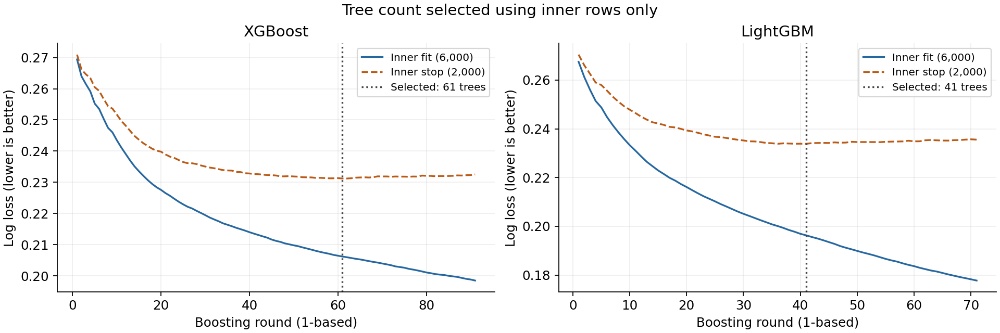

The ROC and precision–recall curves compare the ranking performance of the three baseline models. Logistic Regression achieved the highest ROC-AUC (0.8213), while XGBoost achieved the highest AP (0.3338). With only 7.89% defaults, AP provides particularly relevant evidence for the provisional selection of XGBoost.


## The Second Stage — Validate honestly before tuning

Notebook: `notebooks/02_validation_tuning.ipynb`

**Objectives:** Audit feature availability, enforce forward-time and customer-separated validation with 90-day label maturity, and conduct bounded Optuna tuning.

**Key outcomes:** Removed `days_past_due_60` and `collection_calls`; retained 22 predictors. Three forward folds had zero shared customers and 5,039 eligible OOF rows (50.39% of all data). Eight Optuna trials were completed.

| Validation protocol | ROC-AUC | AP |
|---|---:|---:|
| Leaky random control (unsafe) | 0.9999 | 0.9988 |
| Clean random control (unsafe) | 0.8010 | 0.3110 |
| Honest fixed model | 0.7976 | 0.3153 |
| Honest tuned model | 0.7855 | 0.3133 |

Tuning did not improve outer validation AP over the fixed model. The leaky control is diagnostic only.

#### Graphs

This graph shows the training and validation sizes across three chronological folds. Training sizes increase from 3,223 to 5,731 applications as more historical data become available. The 90-day maturity rule and customer purging ensure that the evaluated folds contain no shared training and validation customers.
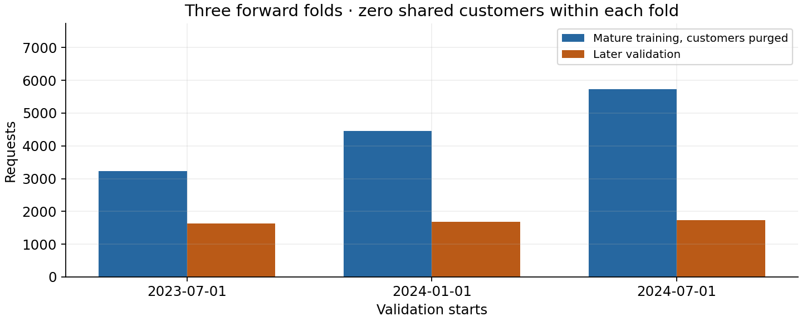

The Optuna search graph tracks mean AP across eight tuning trials using three internal forward folds. It illustrates how hyperparameters are selected using internal validation rather than outer validation outcomes. These search scores are not independent estimates of final model performance.
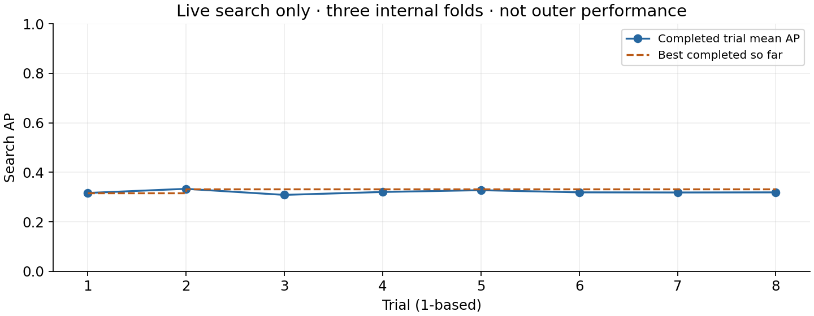

This comparison illustrates how validation design affects reported ROC-AUC and AP. Removing post-outcome features reduced random-control AP from 0.9988 to 0.3110, revealing substantial leakage-related inflation. Honest fixed and tuned models achieved AP of 0.3153 and 0.3133, respectively; the whiskers represent fold standard deviations, not confidence intervals.


## The Third Stage — Choose a decision threshold you can defend

Notebook: `notebooks/03_cost_sensitive_decision.ipynb`

**Objectives:** Compare imbalance strategies, select a cost-sensitive threshold using OOF predictions, enforce per-period review capacity, and audit regional FPR.

**Key outcomes:** Compared unweighted, weighted and oversampled LightGBM on 5,039 OOF applications. The weighted strategy was declared before comparison. Loss = 10 × FN + FP; review capacity is 12% per period.

| Rule | Threshold | Flags | Loss units | Capacity feasible |
|---|---:|---:|---:|---|
| Default | 0.5000 | 1,005 | 2,403 | No |
| Unconstrained minimum loss | 0.4486 | 1,141 | 2,275 | No |
| Constrained minimum loss | 0.6583 | 526 | 2,639 | Yes |

The exact cutoff is `0.6583471436014694` with `>=`. Recall was 40.89%; period flag rates were 8.39%, 10.93%, and 11.89%. The regional FPR gap was 0.6484 percentage points, a descriptive result only. The same threshold was selected for FN costs 8, 10 and 12 in the sensitivity experiment.

#### Graphs

The ROC and precision–recall curves compare unweighted, weighted and oversampled LightGBM using the same forward OOF evaluation framework. They illustrate discrimination under class imbalance, while the subsequent threshold analysis evaluates operational costs and capacity. The weighted strategy was declared before comparison.
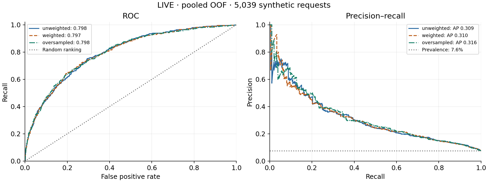

The cost and flag-rate curves show how changing the score threshold affects educational loss and review demand. The unconstrained threshold of 0.4486 minimizes loss but exceeds capacity, whereas 0.6583 produces 526 flags and a loss of 2,639 units while satisfying the 12% ceiling in every period. The plotted loss is normalized per 10,000 applications.
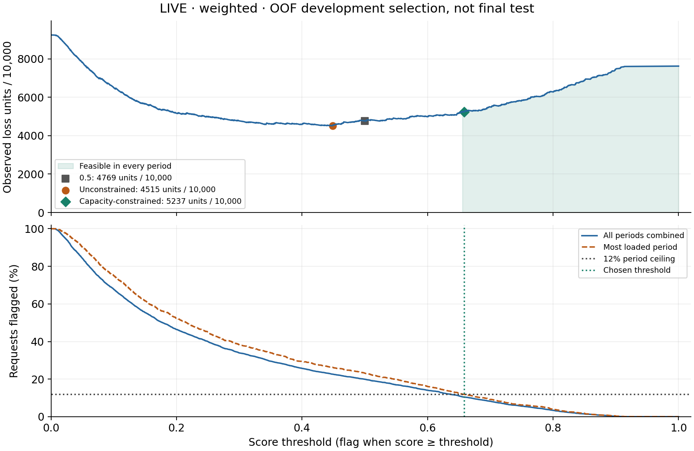

The left panel compares actual review flags with available capacity in each validation period, confirming flag rates of 8.39%, 10.93% and 11.89%. The right panel compares regional false-positive rates, with a maximum gap of approximately 0.65 percentage points. This regional comparison is descriptive and does not establish fairness.
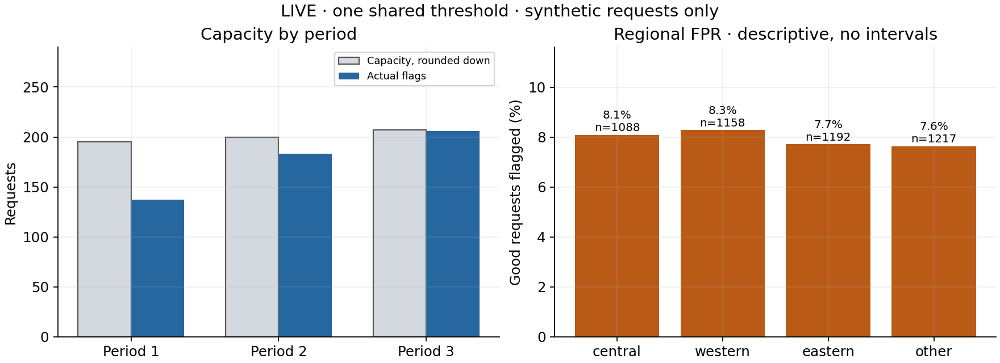

## The Fourth Stage — Explain the model and test its probabilities

Notebook: `notebooks/04_explain_calibrate.ipynb`

**Objectives:** Interpret global and local model behavior using permutation importance and SHAP, evaluate sigmoid calibration on a separate period, and examine stability and review capacity.

**Key outcomes:** The weighted LightGBM model used separate fit, calibration, policy, and evaluation roles. Bureau score and DTI ranked first and second (permutation AP drops 0.1270 and 0.0690; mean absolute SHAP 0.9042 and 0.5437 log-odds). The evaluation set contained 1,733 applications.

| Metric | Raw | Calibrated |
|---|---:|---:|
| ROC-AUC | 0.77080 | 0.77080 |
| AP | 0.25868 | 0.25868 |
| Brier | 0.11303 | 0.06711 |
| ECE | 0.14687 | 0.02249 |
| Log loss | 0.35799 | 0.24675 |

The paired customer-cluster bootstrap Brier-change interval was [-0.05418, -0.03741], conditional on the fixed model and calibrator. Review candidates exceeded capacity in both evaluation quarters (109 vs 100; 122 vs 107). `CAPACITY_REVIEW_REQUIRED` is an acceptable diagnostic outcome; do not retune on evaluation data. Explanations are not causal or fairness evidence.

#### Graphs

The graph compares training gain with permutation importance, which measures the reduction in evaluation AP when a feature group is shuffled. Bureau score and DTI lead the permutation ranking, with AP decreases of 0.1270 and 0.0690. These results indicate predictive reliance rather than causal effects.
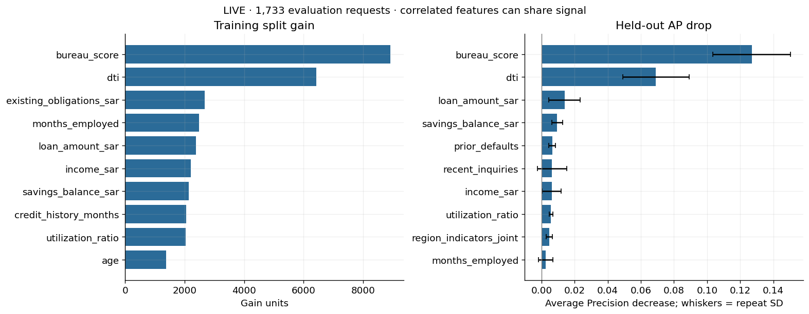

The SHAP beeswarm summarizes feature contributions across sampled evaluation applications. Horizontal position represents the direction and magnitude of contributions to raw log-odds, while color represents feature values. Bureau score and DTI have the highest mean absolute SHAP contributions (0.9042 and 0.5437), indicating their importance to this LightGBM model.
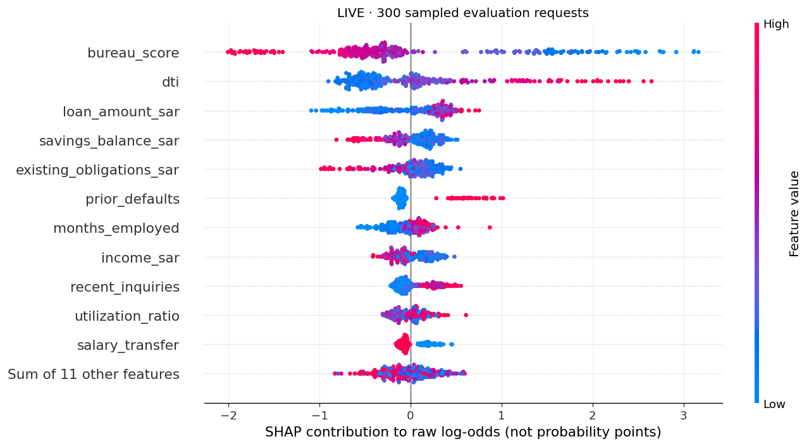

The waterfall explains the individual prediction for application TR-009585 by adding feature contributions to the model baseline in raw log-odds. Bureau score (+2.2693) and DTI (+1.1981) are the largest positive contributors. These are model-specific explanations, not causal reasons or calibrated probability changes.
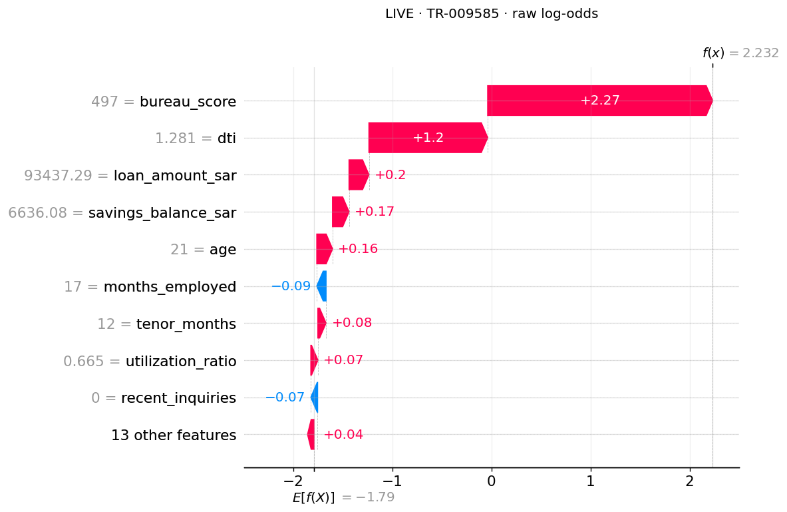

The reliability diagram compares predicted probabilities with observed default rates, alongside the number of applications in each probability bin. Sigmoid calibration improved Brier score from 0.11303 to 0.06711 and ECE from 0.14687 to 0.02249 on the separate evaluation period, while AP and ROC-AUC remained unchanged.
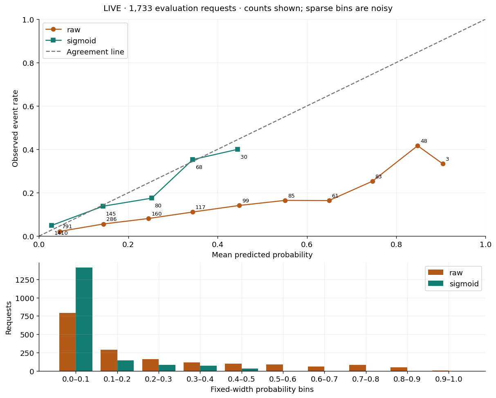

The stability plots summarize customer-cluster bootstrap uncertainty for AP and the paired change in Brier score. The Brier-change interval of [-0.05418, -0.03741] supports improved probability reliability on the evaluation sample, conditional on the fixed model and calibrator. It does not guarantee future performance.
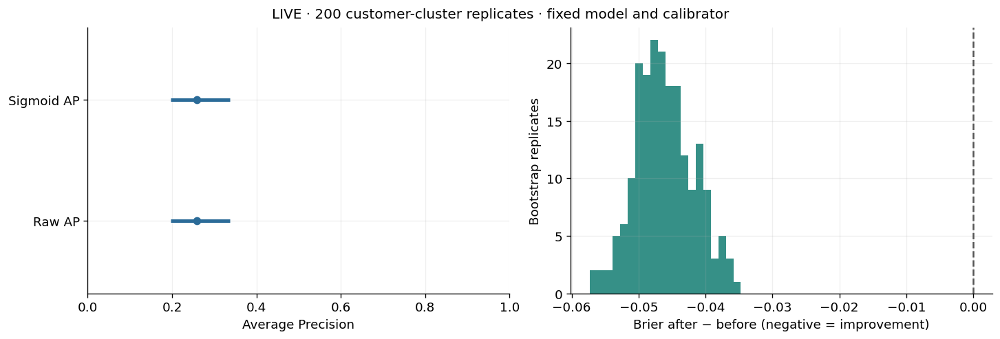

The left panel illustrates the sigmoid mapping and diagnostic review band of ±0.02 around the transported threshold. The right panel compares review demand with capacity by evaluation quarter. Candidate counts of 109 and 122 exceed capacities of 100 and 107, highlighting the need for capacity review without retuning on evaluation data.
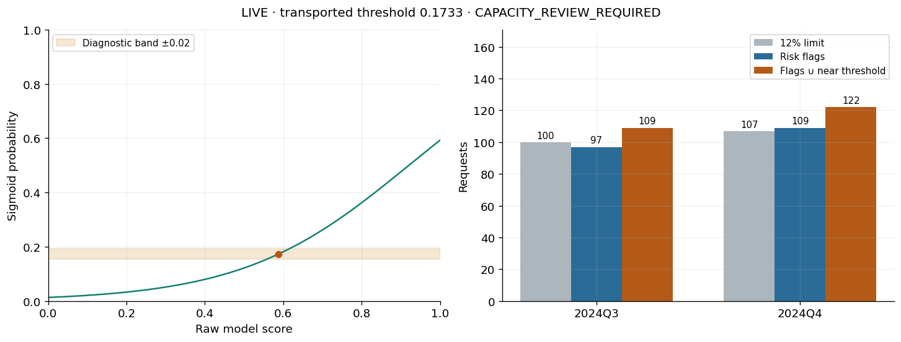


## The Fifth Stage — Choose what is worth shipping and deliver your project

Notebook: `notebooks/05_final_model.ipynb`

**Objectives:** Compare single models and ensembles with nested forward OOF, apply the Worth-It Gate, freeze the model and policy, and score the complete challenge batch reproducibly.

**Key outcomes:** 6,576 fit-and-selection applications, 836 separate calibration applications and 2,155 outer OOF predictions. The six candidates were compared across three folds.

| Candidate | Mean AP | Fold SD | Brier | ECE |
|---|---:|---:|---:|---:|
| LightGBM | 0.34549 | 0.04348 | 0.06608 | 0.02311 |
| XGBoost | 0.35263 | 0.02904 | 0.06566 | 0.02276 |
| Logistic Regression | 0.39166 | 0.02981 | 0.06327 | 0.01882 |
| Equal averaging | 0.37170 | 0.03258 | 0.06435 | 0.02038 |
| Weighted averaging | 0.38942 | 0.02906 | 0.06332 | 0.01772 |
| Stacking | 0.38314 | 0.02949 | 0.06603 | 0.03106 |

**Final decision: KEEP SINGLE → Logistic.** Raw OOF cutoff 0.168922 yielded 245 flags (11.37%), loss 1,111 units and recall 46.93%. The sigmoid mapping transported the threshold to 0.122258. Calibration-fit Brier worsened from 0.07647 to 0.07806, ECE from 0.02112 to 0.03487 and log loss from 0.26649 to 0.27730; these are not independent evaluation metrics.

| Challenge batch | Count |
|---|---:|
| Applications scored | 2,500 |
| Threshold eligible | 330 |
| Removed by capacity | 30 |
| Final review flags | 300 (12%) |

Replay matched and bundle bytes were verified. Challenge outcomes are unavailable, so challenge AP, recall, calibration and loss cannot be measured. Day 4 explanations do not transfer to this final model.

#### Graphs

The correlation heatmaps compare the base models’ OOF predictions and prediction residuals. They help assess whether the models provide complementary information that might justify an ensemble. Diversity alone does not establish an improvement; the ensemble candidates must still satisfy the Worth-It Gate.
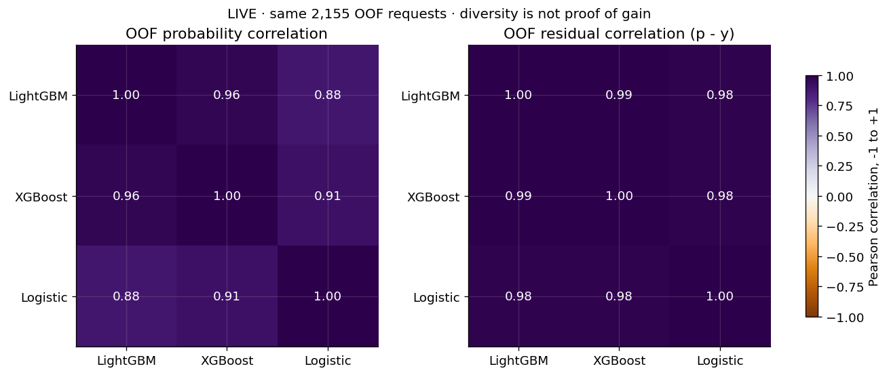

The graph compares mean AP, fold variability, Brier score and ECE across all six candidates before final calibration. Logistic Regression leads with AP of 0.39166, ahead of weighted averaging at 0.38942. No ensemble achieves the required improvement above the reference fold SD of 0.02981, supporting the simpler single-model choice.
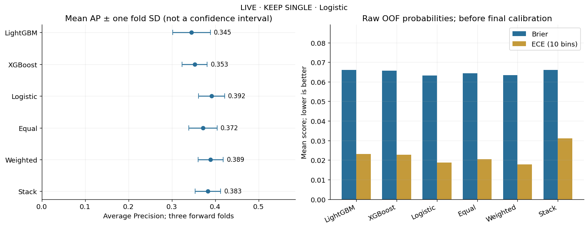

The left panel shows educational loss across raw OOF thresholds and identifies capacity-feasible choices. The selected threshold of 0.168922 yields 245 flags and a loss of 1,111 units. The right panel shows regional false-positive rates with a gap of approximately 3.98 percentage points, a descriptive diagnostic rather than fairness certification.
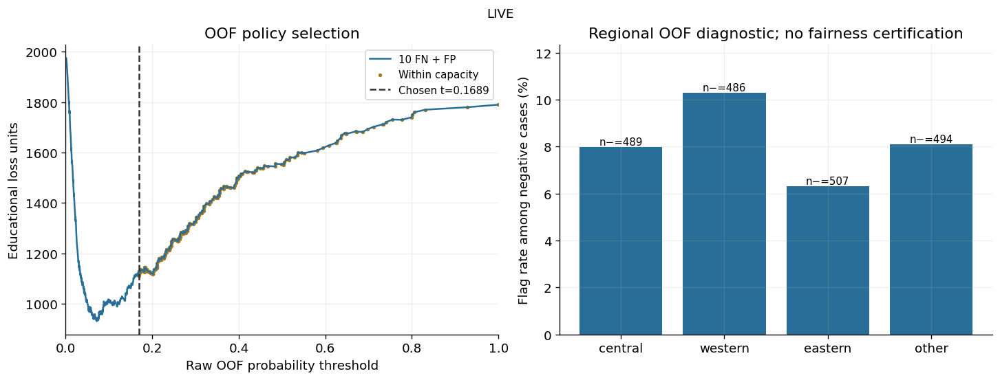

The reliability plots compare raw and sigmoid-calibrated probabilities on the 836 reserved calibration applications. Brier score worsened from 0.07647 to 0.07806 and ECE from 0.02112 to 0.03487, so improved reliability was not demonstrated. These are calibration-fit diagnostics, not independent evaluation results.
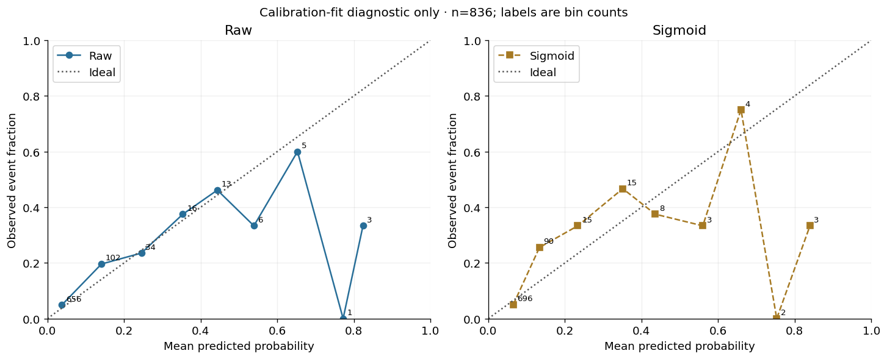

The score distribution shows calibrated probabilities for the 2,500 unlabeled challenge applications and the frozen threshold of 0.122258. Of the 330 threshold-eligible applications, 30 are removed by the capacity policy, leaving exactly 300 review flags (12%). Without challenge outcomes, predictive performance cannot be assessed.
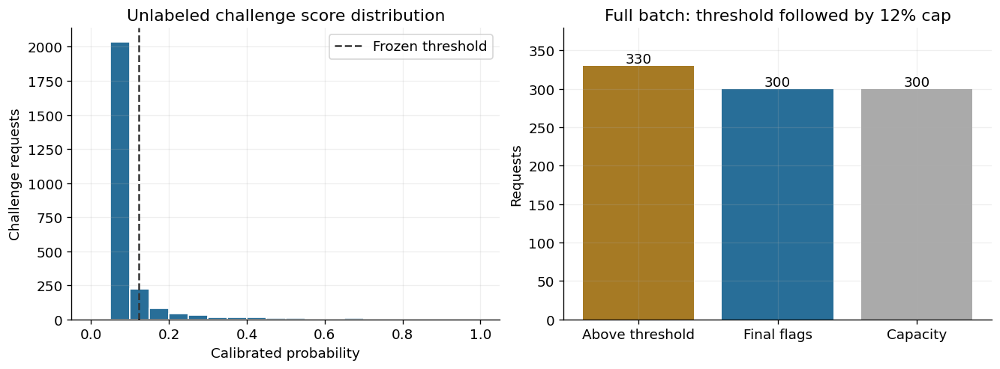

## Daily answers | الإجابات اليومية

### The First Stage

***Which model did you select initially, and what is the strongest result supporting your choice?***

> I initially selected XGBoost as my candidate model because it achieved the highest Average Precision (AP) of 0.3338 among the three models, compared with 0.3258 for Logistic Regression and 0.3248 for LightGBM. Since the dataset is imbalanced, with only 7.89% of applications resulting in defaults, Average Precision is particularly useful for evaluating how effectively the model identifies the minority default class. Although Logistic Regression achieved the highest ROC-AUC (0.8213), XGBoost's stronger Average Precision provides the most relevant evidence supporting my initial selection. This makes XGBoost a promising candidate for further evaluation, rather than a definitive winner.

### The Second Stage

***What leakage risk did you identify, and how did the validation design prevent it?***

> I identified multiple leakage risks, including post-outcome feature leakage, temporal leakage from randomly mixing past and future loan records, customer overlap across training and validation sets, and statistical leakage from global data imputation.

The validation design addressed these risks by:

1. Auditing and removing two post-outcome features, `days_past_due_60` and `collection_calls`, because their information was unavailable at application time. The impact of this leakage was evident when ROC-AUC decreased from 0.9999 in the leaky random control to 0.8010 in the clean random control, while Average Precision decreased from 0.9988 to 0.3110.

2. Enforcing three forward-time chronological splits with a strict 90-day label maturity rule to prevent future-to-past leakage and the inclusion of immature training labels. This excluded 826, 785, and 861 immature training rows across the three respective folds.

3. Purging validation customers from training folds to prevent borrower memorization, resulting in zero shared customers between training and validation across all three folds.

4. Fitting preprocessing transformations, such as imputation, strictly within the relevant training data rather than across the entire dataset to prevent statistical information from validation data influencing model development.

These measures provide a more realistic and trustworthy evaluation of model performance. However, the observed performance gaps are descriptive results from this specific validation experiment and do not guarantee future generalization.

### The Third Stage

***Why is a fixed threshold of 0.5 not always suitable for this review policy?***

> A fixed threshold of 0.5 is not always suitable because it does not account for the asymmetric cost of classification errors or the operational review capacity. In this exercise, a False Negative costs 10 educational loss units, while a False Positive costs only 1 unit. At the default 0.5 threshold, 1,005 applications were flagged, exceeding the 12% review capacity, with a total loss of 2,403 units.

> The unconstrained minimum-loss threshold of 0.4486 reduced the loss to 2,275 units but flagged 1,141 applications, also exceeding capacity. The selected constrained threshold of 0.6583 produced 526 flags and a loss of 2,639 units while satisfying the 12% capacity ceiling in all three validation periods. Therefore, threshold selection must balance classification costs with operational constraints rather than automatically using 0.5.

### The Fourth Stage

***Which feature was most important in your explanation, and why does that not prove causality?***

> The credit bureau score (`bureau_score`) was the most important feature in my model explanation. It ranked first in both permutation importance, with a mean AP drop of 0.1270, and global SHAP importance, with a mean absolute contribution of 0.9042 log-odds.

> However, high feature importance does not prove causality. SHAP and permutation importance measure the model's reliance on predictive patterns and statistical associations rather than establishing a cause-and-effect relationship. Correlated features may also share predictive information. Therefore, changing an applicant's bureau score does not necessarily cause a corresponding change in their actual default outcome.

### The Fifth Stage

***Why did you choose the single model or the ensemble for the final project?***

> I selected Logistic Regression as the final single model based on the worth-it gate applied across three nested forward validation folds. Logistic Regression achieved the highest mean Average Precision (AP) of 0.39166, with a fold standard deviation of 0.02981, a mean Brier score of 0.06327, and a mean ECE of 0.01882.

> The ensemble alternatives, including equal averaging, weighted averaging, and logistic stacking, achieved mean AP scores of 0.37170, 0.38942, and 0.38314, respectively. None exceeded the performance of Logistic Regression, let alone achieved an improvement greater than its fold standard deviation of 0.02981.

> The worth-it gate also required Brier score deterioration of no more than 0.005 and ECE deterioration of no more than 0.01. These educational criteria represent a model selection heuristic rather than a formal statistical significance test.

> Consequently, the notebook returned KEEP SINGLE → Logistic. The simpler Logistic Regression model was retained because the additional complexity of an ensemble was not justified by the observed validation performance. This supports operational simplicity and maintainability without sacrificing observed predictive performance, although future generalization is not guaranteed.

## Reference
Training-program reference: [SDAIA Academy on GitHub](https://github.com/SDAIAAcademy).
